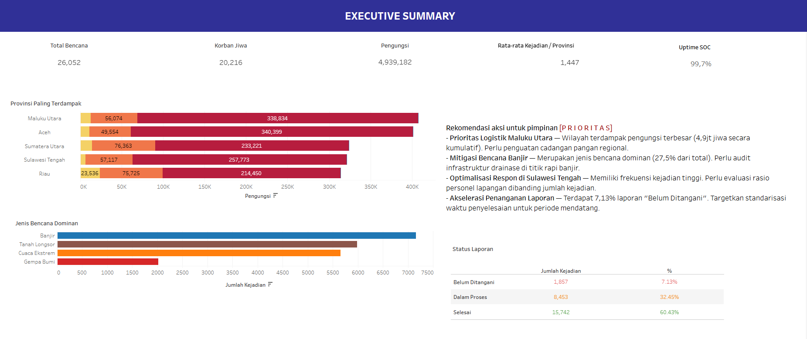

# INDIS Executive Summary
An executive-level Tableau dashboard for monitoring disaster incidents across Indonesia. It condenses 1,000 incident records (January 2024 to December 2025) into headline KPIs, a ranking of the most affected provinces, a breakdown of disaster types and report-handling status, and a short list of recommended priority actions for leadership.

# How To Use
To view the dashboard, download INDIS Executive Summary.twbx file from /dashboards folder and open it using Tableau Public or Tableau Desktop.

# Viewing via Tableau Public
https://public.tableau.com/app/profile/nuzulia.adistianingrum/viz/INDISExecutiveSummary_17911910860420/EXECUTIVESUMMARY-MONITORINGBENCANANASIONAL
